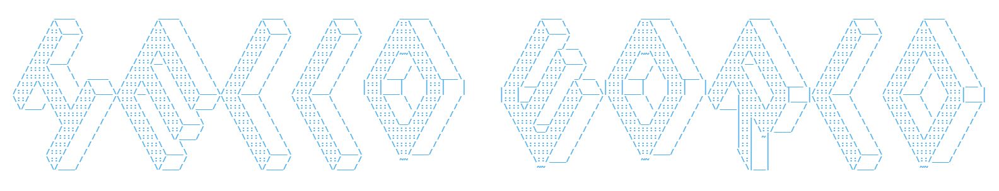

  

 

   

  

Welcome to my cybersecurity portfolio! (^◡^)ﾉ I'm Earnest, an aspiring cybersecurity professional exploring defensive security, threat detection, and identity & access management.

This space is where I document what I'm learning, building, and breaking (on purpose). Here you'll find security labs, technical write-ups, home lab projects, and other hands-on experiments. Right now, I'm working toward the CompTIA CySA+ certification and expanding my home lab environment. As I continue to grow, I plan to share experimental security builds, research projects, and practical explorations of emerging defensive technologies. 

I'm actively seeking opportunities as a **Cybersecurity Analyst, IT Support Specialist, or Data Center Technician** where I can apply analytical thinking, technical troubleshooting, and security best practices to support secure and reliable operations. 

  

 

  

   

 

<table align="center">
<tr>
<td width="50%" valign="top">

## 🔵 EDUCATION

🌐 Information Security Analyst Training Program 
Correlation One // Jul. 2026 
Honors Distinction

---

## 🟠 CURRENT AREAS OF FOCUS

🔹 Defensive Security  
🔹 Cloud Security  
🔹 Threat Detection & Analysis  
🔹 Identity & Access Management (IAM)  
🔹 Home Lab Development  
🔹 CompTIA CySA+ Preparation  

</td>

<td width="50%" valign="top">

## ⚪ CERTIFICATIONS

THM Virtual Workshop: Attacking & Defending AWS  
[TryHackMe // Sep. 2026]  

---

CompTIA Security+ (SY0-701)  
[CompTIA // Jun. 2026]  

---

Adobe Analytics Business Practitioner (AD0-E212)  
[Adobe // Jun. 2025]  

---

Google Analytics (GA4)  
[Skillshop // Dec. 2024]

</td>
</tr>
</table>

 

## Featured Projects

Explore some of the projects I've built and documented:

<!-- SHOWCASE-START -->
## 🚀 My Projects

---
*Updated on November 11, 2026*

<!-- SHOWCASE-END -->

 

  
<picture>
  <source media="(prefers-color-scheme: dark)" srcset="https://raw.githubusercontent.com/earnesttavares/earnesttavares/output/github-snake-dark.svg">
  <source media="(prefers-color-scheme: light)" srcset="https://raw.githubusercontent.com/earnesttavares/earnesttavares/output/github-snake.svg">
  
</picture>

🖱︎ ₍^. .^₎⟆

  

