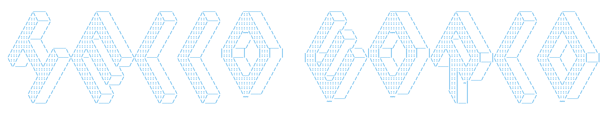

  

  

Welcome to my cybersecurity portfolio! (^◡^)ﾉ I'm an aspiring **cybersecurity professional** focused on defensive security, threat detection, and identity management.   

Here you'll find security labs, technical write-ups, and projects that showcase my hands-on learning and technical development. I'm currently building a foundational home lab environment and preparing for the CompTIA CySA+ certification. As I continue to grow, I plan to share experimental security builds, research projects, and practical explorations of emerging defensive technologies. 

I'm actively seeking opportunities as a **Cybersecurity Analyst, IT Support Specialist, or Data Center Technician** where I can apply analytical thinking, technical troubleshooting, and security best practices to support secure and reliable operations. 

  

 

📋︎ CURRENT AREAS OF FOCUS  
» Defensive Security  
» Cloud Security  
» Threat Detection & Analysis  
» Identity & Access Management (IAM)  
» Home Lab Development  
» CompTIA CySA+ Preparation  
 
 

   

<table align="center">
<tr>
<td width="50%" valign="top">

## ✍︎ EDUCATION

🌐 Information Security Analyst Training Program 
Correlation One // Jul. 2026 
Honors Distinction

---

</td>

<td width="50%" valign="top">

## 🗎 CERTIFICATIONS

THM Virtual Workshop: Attacking & Defending AWS  
[TryHackMe // Sep. 2026]  

---

CompTIA Security+ (SY0-701)  
[CompTIA // Jun. 2026]  

---

Adobe Analytics Business Practitioner (AD0-E212)  
[Adobe // Jun. 2025]  

---

Google Analytics (GA4)  
[Skillshop // Dec. 2024]

</td>
</tr>
</table>

 

  

  
<picture>
  <source media="(prefers-color-scheme: dark)" srcset="https://raw.githubusercontent.com/earnesttavares/earnesttavares/output/github-snake-dark.svg">
  <source media="(prefers-color-scheme: light)" srcset="https://raw.githubusercontent.com/earnesttavares/earnesttavares/output/github-snake.svg">
  
</picture>

🖱︎ ₍^. .^₎⟆

